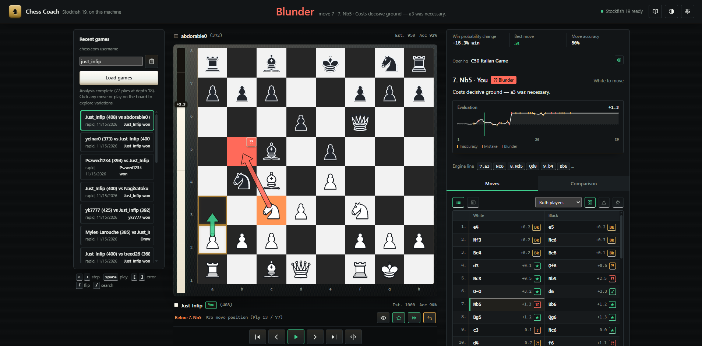
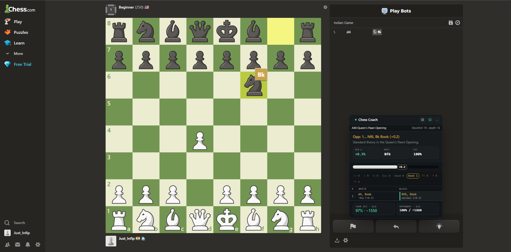
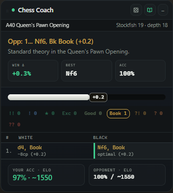
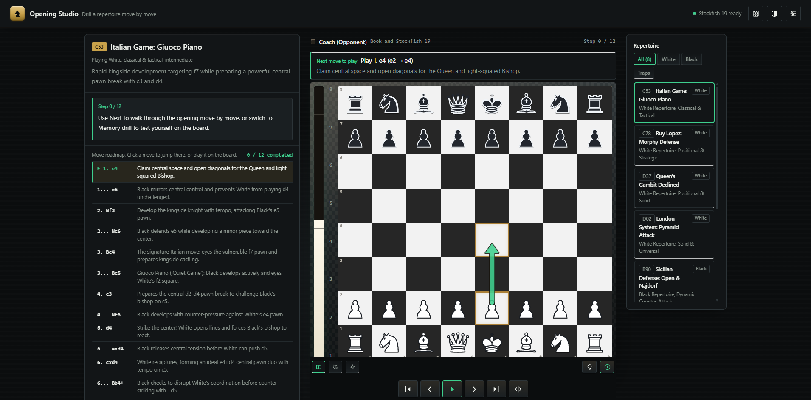

<div align="center">



# Chess Coach

**A Chrome extension that grades every move you play — while you play it — with Stockfish 19 running entirely on your machine.**

Live post-move coaching on chess.com · full interactive Game Review · an Opening Studio for drills.
No accounts. No uploads. No servers. Your games never leave your computer.

[](https://developer.chrome.com/docs/extensions/)
[](https://stockfishchess.org/)
[](#-privacy)
[](LICENSE)

</div>

---

## ✨ What it does

Chess Coach is two tools in one extension:

1. **A live coach that whispers between moves.** While you play on chess.com, a floating panel watches the board and grades each move the moment it lands — classification, the better move, the eval swing — all readable in under a second, mid-blitz.

2. **A full analysis workbench for after the game.** The Game Review page replays your game with chess.com-style grades, a scrubbable evaluation graph, a mistake inspector that steps through the engine's line, accuracy and estimated-Elo scorecards for both players — and an Opening Studio to drill the opening that burned you.

### 🖼️ The surfaces


<p align="center"><sub><b>Game Review</b> — the hero surface. The board takes center stage; the verdict strip, evaluation graph, move inspector and two-column score sheet orbit around it. Click any dip in the graph to jump straight to the mistake.</sub></p>


<p align="center"><sub><b>Live coach, in context</b> — a draggable panel floats over chess.com while you play. A grade badge lands on the move's destination square the moment the move is made, with the opening named in the panel header.</sub></p>

<p align="center">

</p>
<p align="center"><sub><b>The panel up close</b> — verdict card, live eval bar, per-grade breakdown pills and a two-column score sheet that fills in as you play. Minimizes to a quiet pill when you need the screen.</sub></p>


<p align="center"><sub><b>Opening Studio</b> — guided walkthroughs, memory drills and free sparring against Stockfish for eight repertoire lines, from the Italian Game to refuting the Scholar's Mate.</sub></p>

---

## 🚀 Install (Chrome — load unpacked)

1. **Download** this repository (`Code ▾ → Download ZIP`) and unzip it.
2. Open `chrome://extensions` and toggle **Developer mode** (top right).
3. Click **Load unpacked** and select the unzipped `chess-coach` folder.
4. Pin **Chess Coach** from the puzzle-piece menu, then open the popup:
   - toggle **Live coaching**,
   - set your chess.com **username** in Settings (so the coach knows which moves are yours),
   - pick a search depth (12 = bullet-fast, 14 = balanced, 18 = deep).

> **Requirements:** desktop Chrome (or any Chromium browser). The engine is bundled — the 1.8 MB `stockfish.wasm` ships with the extension, so first analysis starts instantly and works offline.

---

## 🎯 The live coach

Open any game on chess.com and the panel appears. What you get between moves:

- **The verdict card** — the grade ("Blunder ??"), the move, and a one-line explanation in plain coach language: *"Costs decisive ground — Qf3 was necessary."*
- **Win Δ / Best / Acc strip** — how much win probability the move swung, what the engine wanted, the move's accuracy.
- **Live eval bar** — white-relative Stockfish evaluation, updated after every move.
- **Grade pills** — your running counts of brilliants, mistakes and blunders.
- **Two-column score sheet** — every move logged White/Black with its grade and eval; click any entry to replay that move's saved analysis.
- **You vs Opponent** — live accuracy and estimated Elo for both players.
- **Board marker** — a grade-colored badge pinned to the move's destination square, flip-aware and resize-proof.

The panel is draggable (double-click the header to reset), collapsible, and remembers where you left it. If the extension is reloaded mid-game, the tab recovers automatically — no "Extension context invalidated" errors.

**Depth settings** (Options page): depth 12 keeps up with bullet, 14 is the default for blitz, 18 for slower games.

---

## 📊 Game Review

Open it from the popup or the overlay. Load games three ways: **your chess.com archive** (last 20 games fetched locally), **paste a PGN**, or **see a sample game** — Morphy's Opera Game, analyzed with zero setup.

While Stockfish sweeps the game (a quiet progress bar ticks along):

- **10 move grades**, chess.com-style: `Brilliant !!` · `Great !` · `Best ★` · `Excellent ✓` · `Good ✓` · `Book Bk` · `Forced =` · `Inaccuracy ?!` · `Mistake ?` · `Blunder ??` — each with its own color *and* glyph, so the grade never depends on color alone.
- **Verdict marquee** — the selected move's grade is the loudest word on the page.
- **Evaluation graph** — scrubbable, grade-colored dip markers, hover for exact evals, click to jump.
- **Win-probability strip** — change / best move / accuracy for the selected move.
- **Mistake inspector** — selecting a mistake or blunder automatically shows the position *before* the move, draws both the played move and Stockfish's recommendation as arrows, and lets you preview the recommendation or step through the full PV without touching the game history.
- **Variation board** — from any position, play your own moves; Stockfish evaluates each one live and draws its suggested follow-up. Press `Return to game` (or `Esc`) to snap back.
- **Score sheet + detailed table** — paired notation with filters (my moves / opponent / critical / highlights), or a full per-ply table.
- **Comparison tab** — accuracy, estimated Elo, ACPL, phase-by-phase accuracy (opening / middlegame / endgame), and a per-grade count for both players, plus a plain-language head-to-head verdict and "what to work on" takeaways.

### ⌨️ Keyboard

| Key | Action | Key | Action |
|---|---|---|---|
| `←` / `→` | step moves | `Space` | play / pause |
| `Home` / `End` | first / last move | `[` / `]` | previous / next mistake |
| `f` | flip board | `/` | focus username search |
| `1` / `2` | review / comparison views | `s` | open Opening Studio |
| `Esc` | exit variation exploration | | |

---

## 🎓 Opening Studio

Eight guided lessons (`coach/coach.html`), each with move-by-move coach commentary, "how to play it" and "how to counter it" strategy notes:

**Italian: Giuoco Piano** · **Ruy Lopez: Morphy Defense** · **Queen's Gambit Declined** · **London System** · **Sicilian: Najdorf** · **Caro-Kann** · **Tackle Scholar's Mate** · **Tackle the Fried Liver**

Three training modes per lesson:

- **Guided** — arrows show every book move; press `Next` or `Space` to demo the line.
- **Memory drill** — no hints; play the line yourself and the coach grades each attempt, showing the book response when you deviate.
- **Free spar** — play anything; Stockfish answers with real evaluation and suggested follow-ups.

The coach's takeaways on the Review page link straight to the matching lesson: blundered in the Najdorf? One click drills the Najdorf.

---

## 🧠 How grading works

Every position gets a real Stockfish 19 search (no heuristics-only shortcuts):

1. **Eval before / after** — the engine evaluates the position before and after each move at your chosen depth (cp scores and mate lines).
2. **Win probability** — centipawns map to win% through the standard logistic curve; the move's *accuracy* derives from the win-probability drop, chess.com-style.
3. **Classification** — the grade combines cp loss bands with context: only legal move → *Forced*; theory match → *Book*; a sound material sacrifice → *Brilliant*; the one move that keeps the edge → *Great*; missed mates and huge swings → *Blunder*.
4. **Scorecards** — accuracy averages per player, ACPL (capped at 300 cp per move), and an **estimated Elo** fitted from accuracy, ACPL and grade counts — anchored to the players' chess.com ratings and rounded to 50, review-style.

Everything is computed in `lib/classify.js` and shared by both the live coach and the Review page, so grades never disagree between surfaces.

---

## 🔒 Privacy

**Nothing leaves your machine.** No account, no telemetry, no analytics.

- The Stockfish engine and the openings book are bundled inside the extension.
- The only network requests are reads of **public** chess.com archives (`api.chess.com/pub/...`) when you explicitly load a game — same data any visitor to your chess.com profile sees.
- Preferences (username, depth, theme, panel position) live in `chrome.storage.sync` and nowhere else.

---

## 🗂️ Project structure

```
chess-coach/
├── manifest.json          # MV3 manifest: storage, scripting, tabs + chess.com hosts
├── background.js          # Service worker: Stockfish bridge + auto-reinjection
├── content/
│   ├── content.js         # Live overlay: move detection, grading, panel UI
│   └── overlay.css        # Overlay styling (dark-first)
├── review/                # Game Review page (board, graph, inspector, tables)
├── coach/                 # Opening Studio (guided / drill / spar)
├── popup/  options/       # Quick toggles + settings
├── lib/
│   ├── chess.js           # chess.js — move legality & PGN
│   ├── engine.js          # Stockfish worker wrapper (queue, timeouts, fallbacks)
│   ├── classify.js        # Grades, Elo estimation, comparison, lessons
│   └── openings.json      # 65 ECO opening lines
├── engine/
│   ├── stockfish.js       # Stockfish 19 (single-threaded WASM build)
│   └── stockfish.wasm
└── assets/                # Icons + UI sprite sheet
```

**Architecture notes for the curious:**

- **No build step.** Plain HTML/CSS/JS ES modules loaded straight from the extension. Clone it, load it, done.
- **Three-tier engine failover.** Content scripts can't always spawn Workers on chess.com (host CSP), so the live coach runs Stockfish inside the background service worker and talks to it over messages. If the extension context dies mid-game, the overlay transparently rebuilds the engine in-tab from cached script + WASM blobs. Extension pages (Review, Studio) use a direct Worker.
- **Triple move detection.** The overlay reads chess.com's move list (figurine icons *and* text SAN), and cross-checks the board's DOM piece map as a fallback — so missed move-list updates never desync grading.
- **Pieces** are the Cburnett set (the Lichess standard, CC-BY-SA 3.0), recolored to the app palette.

---

## 🛠️ Development

```powershell
# no dependencies to install — verify syntax changes with:
node --check background.js
node --check content/content.js
node --check review/review.js
node --check coach/coach.js
node --check lib/engine.js
node --check lib/classify.js
```

Then reload the extension at `chrome://extensions` (↻ on the Chess Coach card). The content script re-injects itself into open chess.com tabs automatically.

---

## 📄 License

Code is [MIT](LICENSE). The bundled pieces are the [Cburnett set](https://commons.wikimedia.org/wiki/Category:SVG_chess_pieces) by Colin M.L. Burnett, licensed **CC-BY-SA 3.0**; Stockfish is bundled as a compiled WASM build under its [GPLv3](https://github.com/official-stockfish/Stockfish/blob/master/Copying.txt) license (source: [stockfishchess.org](https://stockfishchess.org/download/)).

---

<div align="center">
<sub>Built for club players who want the coach's voice between moves — and quiet the rest of the time.</sub>
</div>
